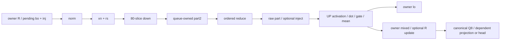

# Strata HC low-rank producer audit, 2026-10-16

S115 confirms that the selected original HC UP kernel computes its low-rank
nonlinear setup before applying the group0-only global-store predicate.
Moving that work to the existing reduce producer is a concrete candidate
for ONE private oracle source preparation. No candidate is implemented,
built, run or measured by this audit.

CONFIG -> n_embd2560/hc4/hc_lr320, normal sliced/non-MORE C16 UP, non-ILP/default GRF,
nsplit=1. Frozen S107 main 064b63ce and archive cf710683 identities reuse prior
root receipts with unchanged pre/post stat continuity. The exact 607880-byte
fused_gr member matches its original object (SHA 27d0ab6a). No new full main,
archive or model hash. Historical S95/S108 records supply context without a
trace reparse or claim that S113 newly traced these kernels.

COMMAND -> CPU-only extraction of exactly the selected original UP/reduce
images, followed by two offline decodes with actual ocloc 7a418c1e in pinned
e41/BMG-G31, UID1000, networknone, noDRI, CPU4 and disk TMP under cpu-run.
The corrected wrapper exits 0 in 12s; both decoders exit 0 and both input
hashes remain unchanged. No production edit, build, GPU or native/model CLI.

The first CPU attempt stopped on a parser predicate: a substring match for
fused_gr_read_multi included generated helpers along with the public entry.
It completed the selected member/object and host bindings, then HOLD before
saving a selected image or running a decoder. Root authorized an exact
public-symbol predicate. The continuation reused the retained member,
verified its hash/bytes against the current original object, and retained
the first HOLD and complete script diff. No repeat archive scan or GPU
retry was needed.

RESULT -> Compiled host relocations resolve Info/cache/guard, linked final
name pointers and one selected image per target. The normal UP host branch
requires grf=false at 0x3c60 ->0x3e41 and ILP=false at 0x3e57 ->0x4041;
its global 0xa000/local 0x100 descriptor gives 160 workgroups/256 threads.
It uses C16 normal Info at host 0x594a (.rodata+0x2240), cache/guard 0x5e0/
0x5e8, not MORE/ILP/grf256. Final main Info is 0xcd9ba0, cache/guard 0x5562260/
0x5562268 and name pointer 0xbb90f8. Public fused_gr_read_multi calls the UP
helper at 0x2b2c; normal reduce submits at 0x17af and resolves its separate
Info 0xcdc958, cache/guard 0x5562720/0x5562728 and name pointer 0xbba047.
Actual full names/relocations/metadata remain in the exact facts record.

S107/S113 configs and complete container Config.Env have no STRATA_GR_*
overrides. Retained native identity is only a configured-key environment
projection, whose absence alone cannot prove full native absence. Together
with inherited child_env source and B70 defaults, the records support the
normal sliced/C16/LO_ONCE branch as source-conditioned lineage. They do not
constitute a new runtime dispatch observation.

| Selected metadata | UP | Reduce |
| --- | ---: | ---: |
| GRF / SIMD | 128 / 32 | 128 / 32 |
| SLM bytes | 12288 | absent: UNKNOWN |
| barrier_count | 1 | absent: UNKNOWN |
| EU thread count | 8 | 8 |
| Spill / scratch | absent: UNKNOWN | absent: UNKNOWN |

UP has two static sync.bar sites despite metadata barrier_count 1; these are
different quantities. Options for both images are exactly
-cl-fp32-correctly-rounded-divide-sqrt. Neither image has a named data/bss/
rodata section; that is not proof of no implicit memory. Raw records retain
two type2 REL entries per image at 76/156 targeting
__INTEL_PATCH_CROSS_THREAD_OFFSET_OFF_R0, without an unverified type meaning.

Actual UP ISA establishes the specific seam:

- Loop starts at 752. Split0 is loaded at 1056 and added to +0 at 1072. Conditional
  later-split additions remain; the normal source path sets nsplit=1.
- Source division by HC is lowered to mul 0.25 at 1720 in this image. A multiply
  by raw 0xbfb8aa3b (-1.442695) at 1728 precedes math.exp at 1744 and add 1 at 1760.
  Two half-SIMD math.invm sites at 1792/1968 and 14 static madm refinement sites
  complete the division sequence. This observed lowering does not authorize
  rewriting the candidate source division or asserting universal FP identity.
- Every active workgroup stages its result into local lo at 2176. Group0 was
  compared at 560; only AFTER nonlinear evaluation does the predicate skip
  global publication for other groups (2192 ->3008). Global lo store is 2992.
  Thus current LO_ONCE restricts global stores while preserving repeated
  nonlinear setup in this selected image.
- The first barrier sequence 3088..3200 contains SLM/UGM group fences, signal
  and sync.bar at 3200. The first w_up vector load is 6448, after pointer selection
  and that barrier. Its address follows the source w_up base,640-byte row
  stride and16-byte lane stride. Earlier UGM loads serve payload/partials.
  Static instruction order establishes no elapsed wait or device idle time.

Reduce contains 80 static a64 partial-load sites and 80 ordered FP32 adds in
one accumulator chain, with first-slice+0 and final value in r108. It retains
raw part and optional injection publication, with no math.exp/math.invm/
sync.bar sites. The candidate adds only the existing UP split0+0/division/
SiLU sequence after that raw-part write, publishes owner lo, and lets UP
load it into unchanged SLM. Both the reduction's initial+0 AND the UP extra
+0 remain separate FP obligations. All other UP dot/FMA/XOR/gating/residual/
mean arithmetic and four kernel boundaries stay intact.

Both kernels literally OR CR0 with 0x400004C0 (UP 328/reduce 280). The audit
does NOT interpret denormal, rounding, exception or inherited/reset mode
semantics. It does not prove that a reduced value cannot be negative zero.
Signed-zero, subnormal, nonfinite, source division and native-exp behavior
remain strict old/new obligations, including store/load rounding boundaries.

Static UP prologue loop 752..3008 contains one math.exp, two math.invm and 14
madm sites. These include predication/refinement paths and loop bodies;
160 workgroups and source expression counts are not dynamic executed counts,
SFU traffic, cycles, bandwidth or attainable speedup. Later UP nonlinear
sites are outside this candidate seam. Adding a nonlinear epilogue to the
small reduce grid can offset an UP improvement; only a later whole-read
comparison can decide usefulness. S95's 6.7188175ms HC family service is not
a removable wall-time budget or a current speed forecast.

Static readiness order, not measured waiting:

The candidate relocates only low-rank activation from UP to reduce. It
preserves raw part2/part, injection, owner lo and existing visibility across
the reduce->UP kernel boundary. Actual caller arena spans and per-queue
scratch lifetimes remain separate from compiled host binding; no generic
public-alias safety follows. Legacy prefill and other HC paths stay outside
this proposal.

VERDICT -> The mechanism survives the selected ORIGINAL-image audit. Root
read the exact findings and UP/reduce source-ISA excerpts and accepted ONE
private oracle SOURCE PREPARATION ONLY, separately numbered S116. That
preparation is not a completed build/runtime result. Before any future GPU
GO, bind original and new unique images and inspect ordered FP dataflow,
CR0/options/resources and unchanged UP arithmetic, with register/scheduling
changes explicit. Raw image/text equality is a stronger, separate claim.

The proposed strict fixture compares raw part2/part/injection before UP,
candidate lo-before-UP against original lo-after-UP, all final R/lo/rs/
injection/mixed/xn/tails/guards and read-only inputs. Use existing bounded
T1/2/6 x apply0/1 x inject0/1 anchors plus changing A-B-A eager/captured
inputs and small signed-zero/subnormal/nonfinite epilogue cases. A mismatch
means HOLD, without tolerance or a retry. No serving campaign or tuning
sweep is selected by this audit.

No NEW actual model consultation occurred after S115's decodes. The prior
conditional source reviews were claude-opus-5-5/55.236s and
claude-fable-5-1/64.737s, both exit 0; their exact answers and root corrections
are retained in the [S113 postreviews](../strata/flash-next/lowlevel_probe/attention_value_fixed_policy_s113/postreviews/root-post-decision.json).
Both recommended an existing-image check before a private fixture; root
authorized that bounded audit. Neither establishes source bit-equivalence,
zero denorm risk or a savings forecast.

[Exact S115 records](../strata/flash-next/lowlevel_probe/hc_lowrank_producer_s115/README.md)
retain scripts, first HOLD/correction, bounded source/host/ISA excerpts,
metadata/inventories, opcode summaries and actual closure. Full 736796-byte
device ASM, full host ASM, images and member binaries remain external with
recorded hashes; curation does not reread/rehash them. The
[existing data map](../strata/flash-next/data-map/README.md) provides the
larger path context without changing its historical operation rows.
