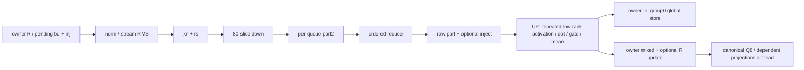

# S115 HC low-rank producer audit, 2026-10-16

CONFIG -> Original normal HC C16 UP and sliced reduce in frozen S107 main
064b63ce75d7568db541af5cf24eee07f41d0e54ea49813af9958a816d75d5ca,
existing kernel archive cf710683aec404599d1cc6173bf8364e6d30731bda82b315df286bf58aed9b38.
Full identities reuse prior root receipts/stat continuity; no new full
main/archive/model hash. Only the exact 607880-byte fused_gr member is checked
against the original object. No candidate implementation, build or GPU work.

COMMAND -> One corrected CPU-only selected-image extraction plus two offline
ocloc disasm calls, pinned e41, BMG-G31, UID1000/networknone/noDRI/CPU4/disk
TMP, serialized under cpu-run. Corrected wrapper exits 0 in 12s; both decoders 0
and both input hashes unchanged. Initial overly broad public-entry symbol
predicate stopped before any decoder; retain that HOLD and its correction.
The continuation reuses/rechecks the already extracted exact member rather
than rescanning the archive. This is a parser correction, not a GPU retry.

RESULT -> Actual host Info/cache/guard/name pointers bind exactly two images.
Normal UP C16/non-GRF/non-ILP uses 160 groups/256 threads. S107/S113 configs,
container environment and child_env source support the normal default branch;
this is source-conditioned lineage, not a new runtime dispatch observation.
The UP prologue contains the split0 +0 add, scale, exp/division refinement,
SLM publication and group0-only GLOBAL store. Nonzero groups skip the store
AFTER computing the nonlinear result. First weight vector load follows the
first barrier. Reduce retains80 ordered partial-load/add sites and no
nonlinear chain. The specific producer-activation mechanism survives this
original-image inspection, with performance and new-kernel correctness open.

VERDICT -> Root accepted ONE private oracle SOURCE PREPARATION ONLY (S116).
No new model consultation followed these S115 decodes. Prior conditional
source consultation was claude-opus-5-5/55.236s and claude-fable-5-1/64.737s,
recorded under the S113 bundle. Raw CR0 bits are not interpreted as denormal
semantics; absent resources remain UNKNOWN. Source/static counts/geometry
are not cycles, traffic, idle time or attainable savings. Strict old/new
intermediate/final bytes and an actual new-image FP/ordering audit must
precede any separately authorized runtime or whole-read timing.

Static readiness order, not measured waits:

The candidate moves only completed low-rank activation into the existing
reduce epilogue and makes UP load owner lo into its unchanged SLM. It keeps
four kernel boundaries, raw part/part2, injection and UP dot/gating/mean.
Owner arenas and per-queue scratch lifetimes are separate contracts; this
audit supplies no general public-alias guarantee. See the
[dated findings](../../../../docs/20261016_strata_hc_lowrank_producer.md) and
[existing data map](../../data-map/README.md) for broader context.

Evidence layout:

- source-candidate/: exact original source audit, buffer/lifetime/FP ledger,
  bounded source excerpts, lo-reader scan and existing S95 aggregate subset.
- offline-audit/: corrected extraction/decoder scripts, source/host/ISA
  excerpts, selected metadata and bindings, opcode summary, raw relocation
  inventory, execution/validation closure and original first parser HOLD.
  parser-correction.diff is derived from the two exact retained audit scripts.
- prior-consultation/: exact prior S113 root decision. Actual prior model
  answers/filtered local metadata are linked from the S113 bundle; no
  additional models are implied by this stage.
- record-copies.json: exact copied source paths/bytes/SHA.
- external-artifacts.json: recorded original image/member/full ASM identities,
  with no new binary/ASM/archive/model read or hash during curation. The full
  device ASM is 736796 bytes; host ASM also remains external. Bounded exact
  source-isa-excerpts and summaries are copied for review.

External root:
`/mnt/vm_8tb/b70/results/flashnext_ista_gsq_rco_iq3xxs_strata_cachefix_20261014/`.
Preserved scripts contain historical external paths and are evidence, not
runnable in-place templates. Historical source-only statuses remain exact.
